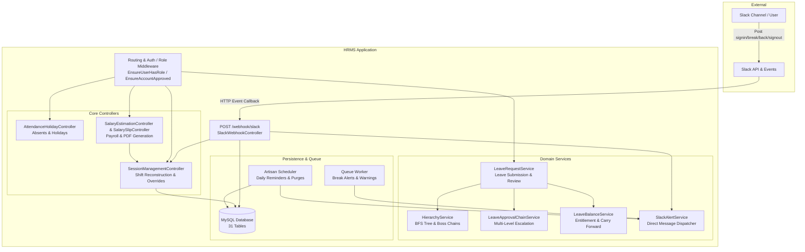

# BeetleOps HRMS — Project Knowledge Pack
## 00-START-HERE.md: Executive Orientation & Quick-Start Guide

---

### 1. Executive Summary

**BeetleOps HRMS** is a monolithic, enterprise Human Resource Management System built on the **Laravel** framework (PHP 8.3+). It operates as the central workforce operations, attendance, leave approval, and payroll calculation platform for the organization.

The core differentiator of this system is its **touchless Slack presence synchronization**: instead of biometric card scanners or manual punch clocks, employees send natural language messages into a dedicated Slack channel (e.g., `signin`, `break`, `back`, `signout`, or retroactive modifications like `signin at 10:00 am`). The system processes these events via Slack webhook APIs, cryptographically verifies signatures, reconstructs multi-segment daily work shifts across midnight boundaries, enforces a 60-minute break policy with a 15-minute grace period, and feeds reconstructed work hours directly into a monthly payroll estimation and PDF salary slip generation pipeline.

---

### 2. Primary Technology Stack

| Layer | Technologies |
|---|---|
| **Backend Framework** | Laravel 11/12 (`laravel/framework: ^13.8` in composer config), PHP 8.3+ |
| **Architecture** | MVC Monolith with dedicated Domain Services & Event-Driven Database Notifications |
| **Database** | MySQL 8.0+ (InnoDB engine, utf8mb4 charset, strict relations) |
| **Frontend UI** | Laravel Blade Templates, Bootstrap 5.3, Tailwind CSS, Alpine.js, jQuery, Dark Spotify Glassmorphism theme |
| **External Integrations** | Slack Events API & Webhooks, Slack Bot OAuth DM API (`chat.postMessage`), Spatie Browsershot (Puppeteer / Headless Chrome), PhpSpreadsheet |
| **Queue & Scheduling** | Laravel Database Queue (`jobs`, `failed_jobs`), Artisan Console Scheduler (`routes/console.php`) |
| **Asset Pipeline** | Vite 8 + Laravel Vite Plugin + PostCSS |

---

### 3. Application Boundaries & Major Portals

The codebase exposes three distinct application interfaces and one automated webhook endpoint:

1. **Super Admin Portal (`/super-admin/*`)**
   - Controlled by middleware `role:super_admin`.
   - Used by top executive roles: CEO (`special_order = 1`), CTO (`special_order = 2`), and HR Manager (`special_order = 3`).
   - Capabilities: User provisioning, organizational chart hierarchy management, department & designation management, custom leave types & annual quota configuration, attendance and company holiday declarations, retroactive Slack session override approval queue, monthly salary estimation, and salary slip PDF emailing.

2. **Staff Portal (`/admin/*`)**
   - Controlled by middleware `role:staff,guest` and gated by `account.approved`.
   - Dual persona interface: serves both regular individual contributors (leaf nodes) and line managers (nodes with direct reports).
   - Regular staff: View personal track record, submit/cancel/modify leave requests, view organizational tree.
   - Line managers: Additionally view team attendance logs, team directory, approve/reject direct subordinate leave requests, participate in multi-tier approval chains.
   - Guests (`role:guest`): External supervisors who can supervise subordinates but cannot apply for employee leaves.

3. **Public Documentation Site (`/docs/{path?}`)**
   - Publicly accessible interactive markdown viewer located in the `doc website/` root folder.
   - Houses role-specific user manuals (Admin, Manager, Employee, Getting Started, Reference).

4. **Slack Real-Time Webhook (`/webhook/slack`)**
   - Public endpoint exempted from CSRF verification.
   - Authenticated via Slack HMAC-SHA256 signature verification (`X-Slack-Signature`).
   - Ingests new messages, message edits, and deletions; drives automatic user profile mapping, break alerts, and session reconstruction.

---

### 4. High-Level System Architecture

---

### 5. Critical Invariants to Understand First

1. **Executive Hierarchy Spine**:
   The organization's root node is the CEO (`special_order = 1`). Below the CEO is the CTO (`special_order = 2`), followed by the HR Manager (`special_order = 3`). Regular staff attach to their designated `manager_id`. If an employee has no `manager_id`, they automatically attach to the HR Manager.
2. **Dynamic Boss Chain**:
   Leave approvals do not use hardcoded department managers. Instead, `LeaveApprovalChainService` traverses upward using `HierarchyService::getBossChain()`. The number of approval levels required is dynamically read from `SystemSetting::approvalLevels()`.
3. **Session Auto-Healing & Overnight Shifts**:
   Employees often work overnight (e.g., check in at 8:00 PM and check out at 4:00 AM). Sessions are grouped by looking ahead 24 hours into the next calendar day. If an employee signs in on a new day without signing out of a previous day, the system auto-appends a virtual sign-out 1 minute after their check-in and dispatches a Slack reminder.
4. **Break Allowance & Grace Period**:
   Daily break allowance is 60 minutes. An invisible 15-minute grace period buffer is added internally. If an employee exceeds 75 minutes of total break time, any additional break duration is automatically converted into an unpaid session-out.
5. **No Test Suite in Active Repo**:
   The test directory was cleaned up in June 2026. Verification currently relies on manual testing, artisan commands, and standalone scratch scripts. Extreme care is required when modifying core services.

---

### 6. Recommended Reading Order

To rapidly understand the codebase, read the documentation files in this order:

1. [`01-PROJECT-OVERVIEW.md`](file:///Users/adeelbukhari/Documents/Projects/hrms/.ai-project-context/01-PROJECT-OVERVIEW.md): Detailed business rules and functional domains.
2. [`03-ARCHITECTURE.md`](file:///Users/adeelbukhari/Documents/Projects/hrms/.ai-project-context/03-ARCHITECTURE.md): System architecture and data flow.
3. [`06-DATABASE.md`](file:///Users/adeelbukhari/Documents/Projects/hrms/.ai-project-context/06-DATABASE.md): Complete schema and Entity-Relationship diagram.
4. [`05-DOMAIN-MODEL.md`](file:///Users/adeelbukhari/Documents/Projects/hrms/.ai-project-context/05-DOMAIN-MODEL.md): State transitions and calculation rules.
5. [`08-AUTH-AND-PERMISSIONS.md`](file:///Users/adeelbukhari/Documents/Projects/hrms/.ai-project-context/08-AUTH-AND-PERMISSIONS.md): Roles, hierarchical authority, and middleware guards.
6. [`15-IMPORTANT-FLOWS.md`](file:///Users/adeelbukhari/Documents/Projects/hrms/.ai-project-context/15-IMPORTANT-FLOWS.md): Step-by-step tracing of the 15 most critical execution flows.
7. [`16-RISKS-AND-TECH-DEBT.md`](file:///Users/adeelbukhari/Documents/Projects/hrms/.ai-project-context/16-RISKS-AND-TECH-DEBT.md) & [`18-BUG-SUSPECTS.md`](file:///Users/adeelbukhari/Documents/Projects/hrms/.ai-project-context/18-BUG-SUSPECTS.md): Fragile areas, known tech debt, and code patterns requiring caution.
8. [`25-AI-HANDOFF.md`](file:///Users/adeelbukhari/Documents/Projects/hrms/.ai-project-context/25-AI-HANDOFF.md): Master briefing tailored for AI coding assistants.
