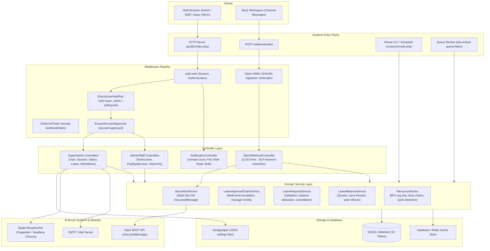
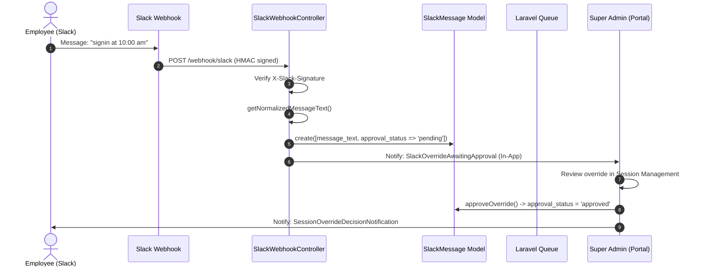
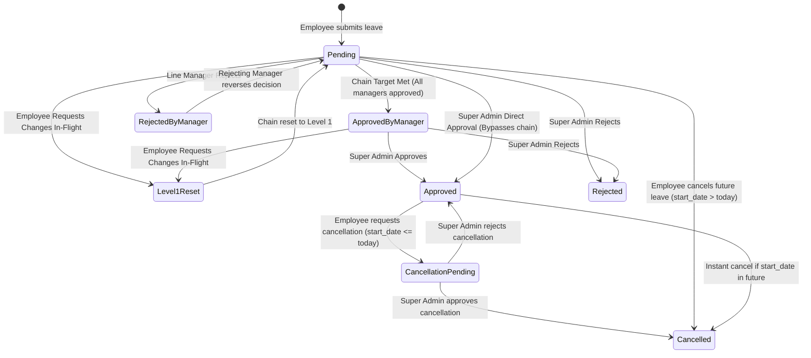

# BeetleOps HRMS — Project Knowledge Pack
## 03-ARCHITECTURE.md: Detailed System Architecture

---

### 1. Architectural Style & Paradigm

BeetleOps HRMS is architected as a **Layered Model-View-Controller (MVC) Monolith** augmented with:
1. **Domain Service Layer**: Dedicated domain services (`app/Services/`) encapsulating complex multi-model business logic (hierarchy traversal, approval chains, leave balance math, Slack alerts).
2. **Event-Driven Database Notifications**: 24 distinct notification classes stored in the `notifications` table, powering the real-time notification bell, in-app drawer, and action-redirect routing.
3. **Touchless Real-Time Ingestion Engine**: An event-driven Slack webhook processing pipeline that accepts real-time messaging callbacks, parses NLP keywords, validates cryptographic HMAC signatures, and computes break and session metrics on the fly.
4. **Reactive Cache Invalidation Pipeline**: Model lifecycle events in `AppServiceProvider` that bust hierarchical organizational tree cache versions whenever users, departments, designations, attendance, or leaves change.

---

### 2. High-Level Architectural Diagram

---

### 3. Subsystem Deep-Dives

#### A. Touchless Slack Presence & Session Reconstruction Subsystem

Unlike traditional HRMS architectures that rely on physical badge-ins or explicit clock-in buttons, BeetleOps HRMS derives daily presence from raw Slack chat messages:

1. **Ingestion**: A user sends `signin`, `break`, `back`, `signout`, or retroactive modifications (`signin at 10 am`) in the Slack channel.
2. **Verification & Normalization**:
   - `SlackWebhookController::handle()` validates the HMAC-SHA256 signature against `config('services.slack.signing_secret')`.
   - `getNormalizedMessageText()` extracts the canonical keyword and parses optional retroactive AM/PM times.
3. **Session Reconstruction (`SessionManagementController::reconstructSessions()`)**:
   - Work hours are not stored as pre-calculated static timesheet rows. Instead, the system queries raw `slack_messages` for a user within a 24-hour lookahead window in the `Asia/Karachi` timezone.
   - It pairs `signin`/`back` events with corresponding `signout`/`break` events.
   - If an employee checks in on Day 2 without closing Day 1, an automatic virtual sign-out (`auto-append`) is generated 1 minute after their check-in, and the user is alerted.
4. **Break Policy & Grace Period**:
   - Daily break balance is 60 minutes (`BREAK_BALANCE_SECONDS = 3600`).
   - A hidden 15-minute grace period buffer (`BREAK_GRACE_PERIOD_SECONDS = 900`) is added invisibly before deductions take effect.
   - If an employee's total breaks exceed 75 minutes, subsequent break time is classified as unpaid time off (`break_exceeded = true`).
   - Queued delay jobs (`BreakBalanceWarningJob`, `BreakGracePeriodAlertJob`, `BreakBalanceAlertJob`) fire automated alerts at 10m remaining, 5m remaining, grace period start, and balance exhaustion.

---

#### B. Leave Management & Dynamic Approval Chain Subsystem

The leave management subsystem enforces strict data integrity, quota tracking, and multi-tier organizational review:

1. **Quota Management (`LeaveBalanceService`)**:
   - For each active user and active leave type, a `leave_balances` record exists per year (`entitled`, `used`, `pending`, `carried_forward`).
   - When submitting a leave, `pending` days increase immediately.
   - `assertNoOverlap()`, `assertNotHoliday()`, `assertNotAbsent()`, and `assertNotRemote()` prevent conflicting records.
2. **Dynamic Hierarchy Escalation (`LeaveApprovalChainService`)**:
   - When a leave request is submitted, `approval_chain_target` is snapshotted from `SystemSetting::approvalLevels()` (e.g., 2 levels).
   - `getNextApprover()` inspects the applicant's manager hierarchy upward (`HierarchyService::getBossChain()`).
   - Level 1 manager approves -> `approval_chain_progress` advances to 1. Level 2 director approves -> `approval_chain_progress` reaches target -> status transitions to `approved_by_manager` awaiting final Super Admin sign-off.
3. **In-Flight Change Requests**:
   - If an employee modifies dates or leave types during the approval process, the original request is snapshotted into `change_request['original']`, and `resetChain()` deletes intermediate approval records and resets `approval_chain_progress` to 0 (restarting at Level 1).
4. **Active/Past Leave Cancellation**:
   - Future leaves are cancelled instantly with balance refunded.
   - Leaves where `start_date <= today` require Super Admin approval to prevent retroactively manipulating finalized attendance or payroll.

---

#### C. Payroll Estimation & Salary Slip Generation Subsystem

The financial subsystem bridges attendance logs with payroll disbursement:

1. **Track Record Aggregator (`SessionManagementController::calculateMonthlyTrackRecordData()`)**:
   - For a given employee and month, aggregates: total expected working seconds, actual time logged, total leaves (paid vs unpaid), declared holidays, remote work days, and unexcused absences.
2. **Salary Formula (`SalaryEstimationController`)**:
   - Base Gross Salary: `User::$expected_salary_amount`.
   - Salary breakdown: 70% Basic Salary, 20% House Rent & Travel Allowance, 10% Medical Allowance.
   - Deduction calculation: Evaluated using either `calendar_days` (Base / Total Month Days * Deductible Days) or `working_days` (Base / Working Days in Month * Deductible Days) configured in `storage/app/salary_deduction_settings.json`.
   - Take Away: `(Gross Salary - Total Deductions) + Sales Commission`.
3. **Headless Chrome PDF Rendering (`SalarySlipController`)**:
   - Renders the Blade preview template (`resources/views/super-admin/salary-slips/preview-page.blade.php`).
   - Feeds HTML into `Spatie\Browsershot::html($html)` running Puppeteer Headless Chrome.
   - Captures raw PDF binary buffer, attaches it to `SalarySlipMail`, and dispatches it via SMTP to the employee's `salary_slip_email` (or regular `email`) with configured CC recipients.

---

### 4. Cross-Cutting Concerns

| Concern | Implementation Mechanism | Source Evidence |
|---|---|---|
| **Authentication** | Session cookies (`laravel_session`), bcrypt password hashing | `bootstrap/app.php`, `config/auth.php` |
| **Authorization** | Route middleware (`role:super_admin`, `role:staff,guest`), `account.approved`, Eloquent Policies | `EnsureUserHasRole.php`, `EnsureAccountApproved.php`, `LeaveRequestPolicy.php` |
| **Data Validation** | Form Requests (`LoginRequest`, `ProfileUpdateRequest`) and inline controller rules | `app/Http/Requests/*`, `LeaveRequestService::calculateDays()` |
| **Transactions** | Database transactions (`DB::transaction`) for all balance-modifying operations | `LeaveRequestService.php`, `LeaveBalanceService.php` |
| **Cache Invalidation** | Version-based cache keys (`org_hierarchy_cache_version`), flushed on model lifecycle events | `HierarchyService.php`, `AppServiceProvider.php` |
| **Timezone Anchor** | `Asia/Karachi` explicitly instantiated for all business and calendar calculations | `SlackWebhookController.php`, `SessionManagementController.php`, `routes/console.php` |
