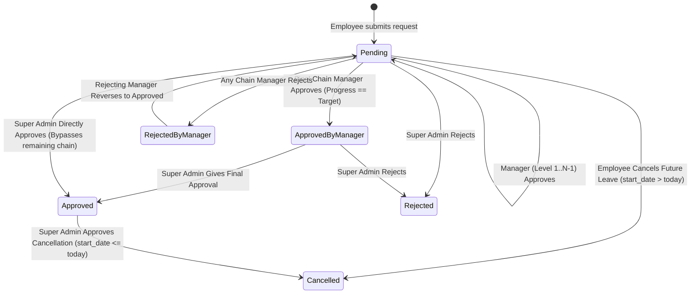
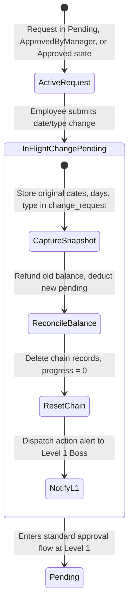
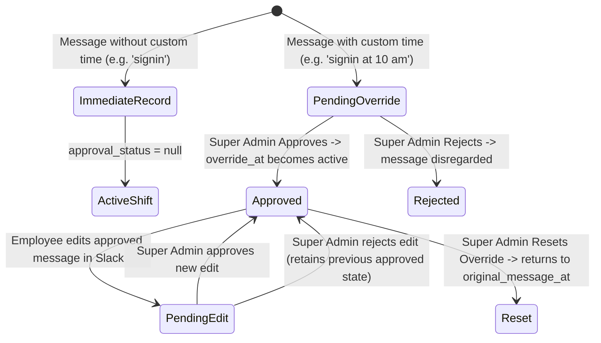

# BeetleOps HRMS — Project Knowledge Pack
## 05-DOMAIN-MODEL.md: Domain & Business Model

---

### 1. Domain Overview & Entity Aggregates

The business domain of BeetleOps HRMS encompasses five core aggregates:

```
┌──────────────────────────────────────────────────────────────────┐
│                      AGGREGATE ROOTS & MODELS                    │
├─────────────────────────┬────────────────────────────────────────┤
│ 1. Identity & Org       │ User (Root), Role, Department,         │
│                         │ Designation, AccountApprovalRequest    │
├─────────────────────────┼────────────────────────────────────────┤
│ 2. Attendance & Slack   │ SlackMessage (Root), SlackMessageEdit, │
│                         │ SlackUserMapping, SlackLeaveSyncMessage│
├─────────────────────────┼────────────────────────────────────────┤
│ 3. Leave Management     │ LeaveRequest (Root), LeaveApprovalChain│
│                         │ LeaveRequestComment, LeaveType,        │
│                         │ LeaveSetting, LeaveBalance, Override   │
├─────────────────────────┼────────────────────────────────────────┤
│ 4. Exceptions & Calendar│ CompanyHoliday (Root), AttendanceRecord│
│                         │ (Absents), RemoteWorkLog               │
├─────────────────────────┼────────────────────────────────────────┤
│ 5. Compensation & Admin │ EmployeeSalarySlipDetail, SystemSetting│
└─────────────────────────┴────────────────────────────────────────┘
```

---

### 2. Core Entities & Attributes

#### A. User Aggregate
- **Entity**: `App\Models\User`
- **Key Attributes**:
  - `id`: Primary key.
  - `name`, `email`, `salary_slip_email`: Identity and dedicated payroll email routing.
  - `role_id`: FK to `roles` (`super_admin`, `staff`, `guest`).
  - `department_id`: FK to `departments`.
  - `designation_id`: FK to `designations`.
  - `manager_id`: Self-referential FK to `users.id` establishing immediate line manager.
  - `special_order`: Executive hierarchy position (1 = CEO, 2 = CTO, 3 = HR Manager).
  - `approval_status`: Registration state (`approved`, `pending`, `rejected`).
  - `expected_salary_amount`: Monthly gross base pay (integer).
  - `sales_commission`: Monthly sales commission (integer).
  - `expected_hour_per_day`: Daily working hours target (typically 8).
  - `expected_hours_per_week`: Weekly target (typically 40).
  - `join_date`: Official company employment start date.

#### B. Slack Presence Aggregate
- **Entity**: `App\Models\SlackMessage`
- **Key Attributes**:
  - `event_id`: Unique Slack event callback ID for deduplication.
  - `slack_user_id`: Slack external user identifier (e.g., `U12345678`).
  - `channel_id`: Slack channel identifier.
  - `message_text`: Normalized keyword (e.g., `signin`, `break`, `back`, `signout`).
  - `slack_ts`: Slack epoch timestamp.
  - `message_at`: UTC timestamp corresponding to `slack_ts`.
  - `approval_status`: Override state (`null`, `pending`, `approved`, `rejected`, `pending_edit`, `merged`).
  - `original_message_at`: Original message timestamp before retroactive modification.
  - `override_at`: Target corrected timestamp requested by employee.
  - `break_exceeded`: Boolean flag indicating whether this break breached the 75-minute daily allowance.
  - `is_auto_appended`: Boolean indicating whether the system generated a virtual sign-out to heal an unclosed shift.
  - `pending_message_text`, `pending_override_at`: Staged modification values when an approved message is edited.

#### C. Leave Request Aggregate
- **Entity**: `App\Models\LeaveRequest`
- **Key Attributes**:
  - `user_id`: Applicant employee FK.
  - `leave_type_id`: FK to `leave_types`.
  - `start_date`, `end_date`: Calendar bounds of requested leave.
  - `days_count`: Float number of billable business days (excluding weekends, scaled by 0.5 if half-day).
  - `reason`: Employee justification.
  - `status`: Lifecycle state (`pending`, `approved_by_manager`, `approved`, `rejected_by_manager`, `rejected`, `cancelled`).
  - `approval_chain_target`: Number of manager approval tiers required (snapshotted at creation).
  - `approval_chain_progress`: Current manager tier completed (0, 1, 2...).
  - `change_request_status`: State of in-flight changes (`null`, `pending`, `approved`, `rejected`).
  - `change_request`: JSON snapshot storing original dates/type and cancellation requests.
  - `is_admin_marked`: Boolean indicating direct administrative grant by Super Admin (bypasses manager chains).

---

### 3. State Machines & Status Transitions

#### A. Leave Request Approval Lifecycle



#### B. Leave Request In-Flight Change Request Lifecycle



#### C. Slack Message Override Lifecycle



---

### 4. Core Business Calculations & Rules

#### 1. Working Days Calculation (`LeaveRequestService::calculateDays`)
- Dates are evaluated between `start_date` and `end_date` inclusive.
- Every day where `$current->isSaturday()` or `$current->isSunday()` is skipped.
- Total days must be strictly greater than `0.0`.
- If `LeaveType::$is_half_day` is true, the computed days count is multiplied by `0.5`:
  $$\text{Days Count} = \text{Working Days} \times 0.5$$

#### 2. Break Balance & Grace Period Rules (`SlackMessage::computeDayBreakBalance`)
- **Daily Break Balance**: 3,600 seconds (60 minutes).
- **Grace Period Buffer**: 900 seconds (15 minutes).
- **Effective Daily Allowance**: 4,500 seconds (75 minutes).
- Breaks are processed chronologically in `[break -> back]` pairs.
- If accumulated break time exceeds 3,600 seconds, the employee enters the grace period. HR receives an alert.
- If accumulated break time exceeds 4,500 seconds, subsequent break time is classified as unpaid session-out (`break_exceeded = true`), and the employee receives a Slack DM.

#### 3. Monthly Salary Deductions (`SalaryEstimationController::computeCompanyPayroll`)
Deductions are calculated according to the rule defined in `storage/app/salary_deduction_settings.json`:
- **Calendar Days Rule (`calendar_days`)**:
  $$\text{Daily Rate} = \frac{\text{Expected Gross Salary}}{\text{Total Days in Month}}$$
  $$\text{Deductible Units} = \text{Absents} + \text{Unpaid Leaves} + \text{Days Prior to Join Date}$$
  $$\text{Total Deductions} = \text{Daily Rate} \times \text{Deductible Units}$$
- **Working Days Rule (`working_days`)**:
  $$\text{Daily Rate} = \frac{\text{Expected Gross Salary}}{\text{Total Working Days in Month}}$$
  $$\text{Total Deductions} = \text{Daily Rate} \times \text{Deductible Units}$$
- **Net Take Away**:
  $$\text{Take Away} = \max(0, (\text{Expected Gross Salary} - \text{Total Deductions}) + \text{Sales Commission})$$
