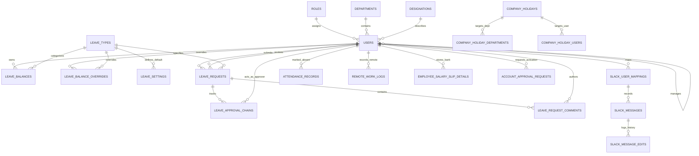

# BeetleOps HRMS — Project Knowledge Pack
## 06-DATABASE.md: Database Architecture & Entity Relationships

---

### 1. Database Configuration & Engine

- **Database Engine**: MySQL 8.0+ (InnoDB Storage Engine)
- **Charset & Collation**: `utf8mb4_unicode_ci`
- **Timezone Storage**: UTC (Standard Laravel datetime storage; all application-level display and reporting converts to `Asia/Karachi`).
- **Migration Strategy**: Sequential Laravel migrations located in `database/migrations/`.
- **Soft Deletes**: Enabled on `users`, `departments`, and `leave_balance_overrides`.

---

### 2. Entity-Relationship Overview

---

### 3. Detailed Table Catalog

#### A. Identity, Roles & Organization Structure

##### 1. `users`
- `id` (bigint unsigned, PK, auto-increment)
- `name` (varchar 255)
- `email` (varchar 255, unique)
- `salary_slip_email` (varchar 255, nullable) — Override email for salary slip deliveries.
- `password` (varchar 255)
- `role_id` (bigint unsigned, nullable, FK -> `roles.id`, null on delete)
- `department_id` (bigint unsigned, nullable, FK -> `departments.id`, null on delete)
- `designation_id` (bigint unsigned, nullable, FK -> `designations.id`, null on delete)
- `manager_id` (bigint unsigned, nullable, FK -> `users.id`, null on delete) — Line manager.
- `special_order` (int, nullable) — 1: CEO, 2: CTO, 3: HR Manager.
- `employee_code` (varchar 255, nullable, unique)
- `phone` (varchar 255, nullable)
- `emergency_number` (varchar 255, nullable)
- `address` (text, nullable)
- `join_date` (date, nullable)
- `expected_salary_amount` (int, nullable) — Monthly gross pay.
- `sales_commission` (int, nullable) — Fixed/default commission amount.
- `expected_hour_per_day` (int, nullable, default 8)
- `expected_hours_per_week` (int, nullable, default 40)
- `approval_status` (varchar 255, default 'approved') — `approved`, `pending`, `rejected`.
- `approved_at`, `rejected_at`, `activation_requested_at` (timestamp, nullable)
- `email_verified_at` (timestamp, nullable)
- `remember_token` (varchar 100, nullable)
- `created_at`, `updated_at` (timestamp)
- `deleted_at` (timestamp, nullable) — Soft deletes.

##### 2. `roles`
- `id` (bigint unsigned, PK)
- `name` (varchar 255, unique) — `super_admin`, `staff`, `guest`.
- `label` (varchar 255) — Human readable label.
- `timestamps`

##### 3. `departments`
- `id` (bigint unsigned, PK)
- `name` (varchar 255)
- `code` (varchar 255, unique) — e.g., `DEV`, `SQA`, `HR`.
- `head_user_id` (bigint unsigned, nullable, FK -> `users.id`, null on delete)
- `head_id` (bigint unsigned, nullable, FK -> `users.id`) — Alternative head reference.
- `timestamps`, `deleted_at` (soft deletes)

##### 4. `designations`
- `id` (bigint unsigned, PK)
- `name` (varchar 255, unique) — Job title (e.g., `Senior Software Engineer`).
- `timestamps`

##### 5. `account_approval_requests`
- `id` (bigint unsigned, PK)
- `user_id` (bigint unsigned, FK -> `users.id`, cascade on delete)
- `status` (varchar 255, default 'pending') — `pending`, `approved`, `rejected`.
- `action_by` (bigint unsigned, nullable, FK -> `users.id`, null on delete)
- `action_at` (timestamp, nullable)
- `timestamps`

---

#### B. Leave Quotas & Application Life Cycle

##### 6. `leave_types`
- `id` (bigint unsigned, PK)
- `name` (varchar 255) — e.g., Casual, Sick, Unpaid, Emergency, Absent.
- `slug` (varchar 255, unique) — `casual`, `sick`, `unpaid`, `emergency`, `absent`.
- `max_days_per_year` (int unsigned, default 0)
- `allow_carry_forward` (boolean, default false)
- `max_carry_forward_days` (int unsigned, default 0)
- `requires_attachment` (boolean, default false)
- `is_active` (boolean, default true)
- `is_half_day` (boolean, default false) — Added in migration `2026_09_15_170000`.
- `timestamps`

##### 7. `leave_settings`
- `id` (bigint unsigned, PK)
- `leave_type_id` (bigint unsigned, FK -> `leave_types.id`, cascade on delete)
- `default_entitled` (int unsigned)
- `timestamps`

##### 8. `leave_balances`
- `id` (bigint unsigned, PK)
- `user_id` (bigint unsigned, FK -> `users.id`, cascade on delete)
- `leave_type_id` (bigint unsigned, FK -> `leave_types.id`, cascade on delete)
- `year` (smallint unsigned)
- `entitled` (decimal 5,1, default 0.0)
- `used` (decimal 5,1, default 0.0)
- `pending` (decimal 5,1, default 0.0)
- `carried_forward` (decimal 5,1, default 0.0)
- `timestamps`
- Unique constraint: `['user_id', 'leave_type_id', 'year']`

##### 9. `leave_balance_overrides`
- `id` (bigint unsigned, PK)
- `user_id` (bigint unsigned, FK -> `users.id`, cascade on delete)
- `leave_type_id` (bigint unsigned, FK -> `leave_types.id`, cascade on delete)
- `year` (smallint unsigned)
- `entitled` (decimal 5,1)
- `timestamps`, `deleted_at` (soft deletes)
- Unique constraint: `['user_id', 'leave_type_id', 'year']`

##### 10. `leave_requests`
- `id` (bigint unsigned, PK)
- `user_id` (bigint unsigned, FK -> `users.id`, cascade on delete)
- `leave_type_id` (bigint unsigned, FK -> `leave_types.id`, cascade on delete)
- `start_date` (date)
- `end_date` (date)
- `days_count` (decimal 5,1)
- `reason` (text)
- `status` (varchar 255, default 'pending') — `pending`, `approved_by_manager`, `approved`, `rejected_by_manager`, `rejected`, `cancelled`.
- `reviewed_by` (bigint unsigned, nullable, FK -> `users.id`, null on delete)
- `reviewed_at` (timestamp, nullable)
- `admin_comment` (text, nullable)
- `approval_chain_target` (int, default 0)
- `approval_chain_progress` (int, default 0)
- `change_request` (json, nullable) — Original parameters snapshot & cancel reasons.
- `change_request_status` (varchar 255, nullable) — `pending`, `approved`, `rejected`.
- `is_admin_marked` (boolean, default false) — Bypasses manager chain.
- `timestamps`

##### 11. `leave_approval_chains`
- `id` (bigint unsigned, PK)
- `leave_request_id` (bigint unsigned, FK -> `leave_requests.id`, cascade on delete)
- `approver_id` (bigint unsigned, FK -> `users.id`, cascade on delete)
- `level` (int) — 1, 2, etc.
- `action` (varchar 255) — `approved`, `rejected`.
- `acted_at` (timestamp)
- `timestamps`
- Unique constraint: `['leave_request_id', 'approver_id']`

##### 12. `leave_request_comments`
- `id` (bigint unsigned, PK)
- `leave_request_id` (bigint unsigned, FK -> `leave_requests.id`, cascade on delete)
- `user_id` (bigint unsigned, FK -> `users.id`, cascade on delete)
- `comment` (text)
- `is_hidden_from_employee` (boolean, default false)
- `timestamps`

---

#### C. Touchless Attendance & Slack Integration

##### 13. `slack_user_mappings`
- `id` (bigint unsigned, PK)
- `slack_user_id` (varchar 255, unique)
- `slack_username` (varchar 255, nullable)
- `user_id` (bigint unsigned, nullable, FK -> `users.id`, cascade on delete)
- `timestamps`

##### 14. `slack_messages`
- `id` (bigint unsigned, PK)
- `event_id` (varchar 255, nullable, unique)
- `slack_user_id` (varchar 255)
- `channel_id` (varchar 255)
- `message_text` (text)
- `is_edited` (boolean, default false)
- `slack_ts` (varchar 255)
- `message_at` (timestamp)
- `approval_status` (varchar 255, nullable) — `pending`, `approved`, `rejected`, `pending_edit`, `merged`.
- `original_message_at` (timestamp, nullable)
- `override_at` (timestamp, nullable)
- `break_exceeded` (boolean, default false)
- `is_auto_appended` (boolean, default false)
- `pending_message_text` (text, nullable)
- `pending_override_at` (timestamp, nullable)
- `timestamps`
- **Performance Indexes**:
  - `idx_slack_messages_user_time` (`slack_user_id`, `message_at`)
  - `idx_slack_messages_approval` (`approval_status`)
  - `idx_slack_messages_auto_appended` (`is_auto_appended`)

##### 15. `slack_message_edits`
- `id` (bigint unsigned, PK)
- `slack_message_id` (bigint unsigned, FK -> `slack_messages.id`, cascade on delete)
- `previous_text` (text)
- `new_text` (text)
- `edited_at` (timestamp)
- `timestamps`

##### 16. `slack_leave_sync_messages`
- `id` (bigint unsigned, PK)
- `leave_request_id` (bigint unsigned, FK -> `leave_requests.id`, cascade on delete)
- `slack_ts` (varchar 255)
- `channel_id` (varchar 255)
- `message_text` (text)
- `is_deletion_locked` (boolean, default false)
- `timestamps`

---

#### D. Exceptions, Holidays & Remote Work

##### 17. `attendance_records` (Admin Marked Absences)
- `id` (bigint unsigned, PK)
- `user_id` (bigint unsigned, FK -> `users.id`, cascade on delete)
- `date` (date)
- `notes` (text, nullable)
- `marked_by` (bigint unsigned, nullable, FK -> `users.id`, null on delete)
- `timestamps`
- Unique constraint: `['user_id', 'date']`

##### 18. `company_holidays`
- `id` (bigint unsigned, PK)
- `name` (varchar 255)
- `date` (date)
- `notes` (text, nullable)
- `declared_by` (bigint unsigned, nullable, FK -> `users.id`, null on delete)
- `target_type` (varchar 255, default 'all') — `all`, `departments`, `users`.
- `timestamps`
- Unique constraint: `['date']`

##### 19. `company_holiday_departments` (Targeting Pivot)
- `id` (bigint unsigned, PK)
- `company_holiday_id` (bigint unsigned, FK -> `company_holidays.id`, cascade on delete)
- `department_id` (bigint unsigned, FK -> `departments.id`, cascade on delete)
- `timestamps`

##### 20. `company_holiday_users` (Targeting Pivot)
- `id` (bigint unsigned, PK)
- `company_holiday_id` (bigint unsigned, FK -> `company_holidays.id`, cascade on delete)
- `user_id` (bigint unsigned, FK -> `users.id`, cascade on delete)
- `timestamps`

##### 21. `remote_work_logs`
- `id` (bigint unsigned, PK)
- `user_id` (bigint unsigned, FK -> `users.id`, cascade on delete)
- `date` (date)
- `notes` (text, nullable) — Contains `'Full Day'` or `'Half Day'`.
- `marked_by` (bigint unsigned, nullable, FK -> `users.id`, null on delete)
- `timestamps`
- Unique constraint: `['user_id', 'date']`
- Performance Index: `idx_remote_work_logs_date` (`date`)

---

#### E. Financial Details, Settings & Notifications

##### 22. `employee_salary_slip_details`
- `id` (bigint unsigned, PK)
- `user_id` (bigint unsigned, unique, FK -> `users.id`, cascade on delete)
- `bank_name` (varchar 255, nullable)
- `account_title` (varchar 255, nullable)
- `account_no` (varchar 255, nullable)
- `iban` (varchar 255, nullable)
- `timestamps`

##### 23. `system_settings`
- `id` (bigint unsigned, PK)
- `key` (varchar 255, unique) — e.g., `approval_levels`.
- `value` (text, nullable)
- `timestamps`

##### 24. `notifications`
- `id` (char 36, PK - UUID)
- `type` (varchar 255) — PHP Notification class name.
- `notifiable_type` (varchar 255)
- `notifiable_id` (bigint unsigned)
- `data` (text / json)
- `read_at` (timestamp, nullable)
- `is_marked` (boolean, default false) — Starred/pinned by user.
- `created_at`, `updated_at` (timestamp)
- **Performance Indexes**:
  - `notifications_notifiable_type_notifiable_id_index`
  - `idx_notifications_unread` (`notifiable_id`, `read_at`)
  - `idx_notifications_marked` (`notifiable_id`, `is_marked`)

---

#### F. Queue & Framework Infrastructure Tables

##### 25. `jobs`
- `id` (bigint unsigned, PK)
- `queue` (varchar 255, index)
- `payload` (longtext)
- `attempts` (tinyint unsigned)
- `reserved_at` (int unsigned, nullable)
- `available_at` (int unsigned)
- `created_at` (int unsigned)

##### 26. `job_batches`
- `id` (varchar 255, PK)
- `name` (varchar 255)
- `total_jobs` (int), `pending_jobs` (int), `failed_jobs` (int)
- `failed_job_ids` (longtext)
- `options` (mediumtext, nullable)
- `cancelled_at`, `created_at`, `finished_at` (int unsigned, nullable)

##### 27. `failed_jobs`
- `id` (bigint unsigned, PK)
- `uuid` (varchar 255, unique)
- `connection` (text), `queue` (text), `payload` (longtext), `exception` (longtext)
- `failed_at` (timestamp, default current_timestamp)

##### 28. `sessions`
- `id` (varchar 255, PK)
- `user_id` (bigint unsigned, nullable, index)
- `ip_address` (varchar 45, nullable)
- `user_agent` (text, nullable)
- `payload` (longtext)
- `last_activity` (int, index)

##### 29. `password_reset_tokens`
- `email` (varchar 255, PK)
- `token` (varchar 255)
- `created_at` (timestamp, nullable)

##### 30. `cache` & `cache_locks`
- Standard Laravel database cache key-value store.
