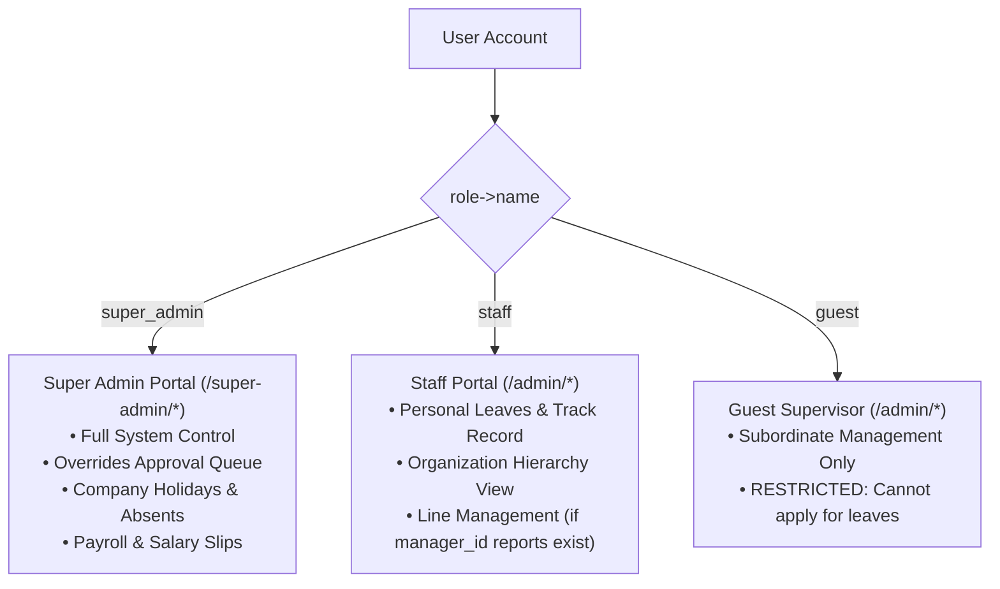
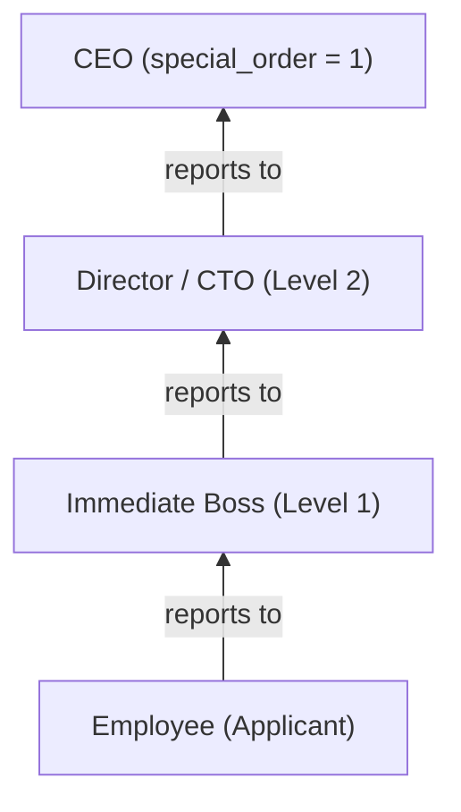

# BeetleOps HRMS — Project Knowledge Pack
## 08-AUTH-AND-PERMISSIONS.md: Authentication, Authorization & Security Architecture

---

### 1. Authentication Mechanisms

#### A. Session-Based Web Authentication
- **Implementation**: Standard Laravel Breeze cookie-based session authentication (`auth:web`).
- **Session Driver**: Configured via `SESSION_DRIVER=database` in `.env.example`, persisted in the `sessions` table.
- **Lifetime**: 120 minutes of inactivity (`SESSION_LIFETIME=120`).
- **Password Security**: Passwords hashed using Bcrypt with 12 rounds (`BCRYPT_ROUNDS=12` in `.env.example`).
- **Throttle Protection**: `LoginRequest` throttles login attempts to 6 per minute (`throttle:6,1`) based on email and client IP.

#### B. Branded Password Reset System
- Custom branded reset email implemented in `AppServiceProvider::boot()` using `ResetPassword::toMailUsing()`.
- Renders `resources/views/emails/reset-password.blade.php` with corporate branding and dynamically resolves link expiration from `config('auth.passwords.users.expire')` (default 15 minutes).

#### C. Two-Tier Account Activation Flow
- **Self-Registration**: Users registering via `/register` or `/register/guest` are created with `approval_status = 'pending'`.
- **Approval Gate**: `App\Http\Middleware\EnsureAccountApproved` intercepts every request to protected staff routes (`/admin/*`).
  - Super Admins and approved users pass through.
  - Pending users are redirected to `admin.dashboard` with a warning notice and restricted from accessing leaves, track records, or organizational hierarchy.
  - JSON requests from unapproved users receive an explicit `403 Forbidden` response.
- **Activation Review**: Super Admins review and activate accounts via `AccountApprovalController` (`/super-admin/users/approvals`).

---

### 2. Role-Based Access Control (RBAC)

The system defines 3 fundamental roles in the `roles` table:



#### Middleware Guard: `App\Http\Middleware\EnsureUserHasRole`
- Registered as `'role'` alias in `bootstrap/app.php`.
- Accepts variable parameters (e.g., `middleware('role:staff,guest')` or `middleware('role:super_admin')`).
- If user role does not match, returns `403 Forbidden` (`{"message": "Unauthorized."}` for AJAX requests).

---

### 3. Dynamic Hierarchical Authority & Boss Chains

Authority in BeetleOps HRMS is not merely role-based; it is **dynamically relational**:



#### A. Executive Hierarchy Spine (`special_order`)
- Users with `special_order` represent the apex of company leadership:
  - `special_order = 1`: CEO (Apex root, manager_id is null / 0).
  - `special_order = 2`: CTO (Reports to CEO).
  - `special_order = 3`: HR Manager (Reports to CTO or CEO; acts as default manager for unassigned staff).
- The organization tree builder in `HierarchyService` treats `special_order` as the master root anchor.

#### B. Subordinate Calculation (`User::getSubordinateIdsAttribute()`)
- To determine if User $A$ has authority to view or approve leaves for User $B$, the system computes all subordinate IDs recursively using a **Breadth-First Search (BFS)** algorithm:
```php
public function getSubordinateIdsAttribute(): array
{
    $visited = [];
    $queue   = [$this->id];

    while (! empty($queue)) {
        $current       = array_shift($queue);
        $directReports = self::query()->where('manager_id', $current)->pluck('id')->toArray();

        foreach ($directReports as $id) {
            if (! in_array($id, $visited, true)) {
                $visited[] = $id;
                $queue[]   = $id;
            }
        }
    }
    return $visited;
}
```
- Safe against potential database reference loops.

#### C. Boss Chain Traversal (`HierarchyService::getBossChain()`)
- Walks upward from an employee's `manager_id` until null or visited, returning an ordered array of manager `User` models `[Level 1, Level 2, ...]`.
- Cycle prevention is enforced prior to saving in `UserController` via `HierarchyService::wouldCreateCycle($user, $bossId)`.

---

### 4. Eloquent Policy Enforcement

Registered in `AppServiceProvider::boot()`:

| Policy | Target Model | Method | Rule / Authorization Logic |
|---|---|---|---|
| `LeaveRequestPolicy` | `LeaveRequest` | `create` | Restricted to `isStaff()` or `isSuperAdmin()`. Returns `false` for `guest`. |
| `LeaveRequestPolicy` | `LeaveRequest` | `view` | Requester can view own; Super Admin can view all; Staff/Guest manager can view if applicant is in `subordinate_ids`. |
| `LeaveRequestPolicy` | `LeaveRequest` | `review` | Super Admin can review `pending` or `approved_by_manager`; Manager can review if applicant is in `subordinate_ids` and status is `pending`. |
| `LeaveRequestPolicy` | `LeaveRequest` | `cancel` | Strict ownership check: `$leaveRequest->user_id === $user->id`. |
| `UserPolicy` | `User` | `view` | Super Admin can view all; Staff/Guest can view self or any subordinate in `subordinate_ids`. |
| `UserPolicy` | `User` | `update` | Super Admin only (`$user->isSuperAdmin()`). |
| `DepartmentPolicy` | `Department` | `manage-departments` | Super Admin only (`$user->isSuperAdmin()`). |

---

### 5. Sensitive Operations & Potential Security Gotchas

1. **Slack Webhook Signature Fallback**:
   - In `SlackWebhookController::handle()`, if `config('services.slack.signing_secret')` is empty or null, signature validation is skipped and only a warning is logged. While intended for local development, this could allow unauthenticated event spoofing if the secret is omitted in production.
2. **In-Flight Change Request Privilege**:
   - `LeaveRequestService::requestChange()` allows employees to alter dates and leave types on approved leaves if they were not admin-marked. The system mitigates risk by forcing a complete chain reset to Level 1.
3. **Public Documentation Route**:
   - `routes/web.php` exposes `/docs/{path?}` publicly without authentication. While protected against path traversal via `realpath()`, internal operational documentation is visible to unauthenticated visitors.
