# BeetleOps HRMS — Project Knowledge Pack
## 10-BACKEND.md: Backend Architecture & Execution Patterns

---

### 1. Architectural Structure & Execution Pipeline

BeetleOps HRMS structures its backend around the **Laravel HTTP Kernel Pipeline**:

```mermaid
flowchart LR
    Request["Incoming HTTP Request"] --> Router["Laravel Router (routes/web.php)"]
    Router --> GlobalMiddleware["Global Middleware (Session, CSRF)"]
    GlobalMiddleware --> AuthMiddleware["auth & verified"]
    AuthMiddleware --> RoleMiddleware["EnsureUserHasRole"]
    RoleMiddleware --> ApprovalMiddleware["EnsureAccountApproved"]
    ApprovalMiddleware --> Controller["Controller Action"]
    Controller --> DomainService["Domain Service Layer"]
    DomainService --> Eloquent["Eloquent ORM Models"]
    Eloquent --> MySQL[("MySQL 8.0 Database")]
```



---

### 2. Domain Service Architecture

To avoid bloating controllers with transactional business rules, business logic is centralized in dedicated Domain Services (`app/Services/`):

#### A. `HierarchyService`
- **Location**: `app/Services/HierarchyService.php`
- **Responsibilities**:
  - `buildFullOrganizationTree(?int $departmentId)`: Cached for 24 hours using a versioned key (`org_tree_v{version}_{dept}_{date}`).
  - `clearCache()`: Increments `org_hierarchy_cache_version` in the Cache store, instantly invalidating cached trees across all users.
  - `computeOrganizationTree()`: Traverses all active users using Breadth-First Search (BFS), attaching executive leadership (`special_order` 1, 2, 3) to the root spine, and anchoring unassigned staff to the HR Manager.
  - `wouldCreateCycle(User $user, int $bossId)`: Walks upward from `$bossId` to verify that `$user->id` is not encountered, preventing circular hierarchy loops.
  - `getBossChain(User $user)`: Returns an ordered array of manager `User` models starting from the immediate boss up to the executive root.

#### B. `LeaveRequestService`
- **Location**: `app/Services/LeaveRequestService.php`
- **Responsibilities**:
  - `calculateDays(string $start, string $end)`: Computes billable days excluding weekends; throws `ValidationException` if zero days or negative range.
  - `submit(User $user, array $data)`: Wraps application creation in a database transaction (`DB::transaction`). Runs strict pre-submission conflict assertions (`assertNoOverlap`, `assertNotHoliday`, `assertNotAbsent`, `assertNotRemote`). Deducts quota by incrementing `pending` days on `LeaveBalance`.
  - `cancel(LeaveRequest $request, User $user, ?string $reason)`: Instant balance refund for future leaves; creates Super Admin cancellation review for active/past leaves.
  - `requestChange(LeaveRequest $request, array $data, User $user)`: Snapshots original request into JSON, re-validates new dates, restores old balance, deducts new balance, and calls `LeaveApprovalChainService::resetChain()` to restart the approval chain from Level 1.
  - `approve()` & `reject()`: Transitions state, moves balance from `pending` to `used` (on approval) or releases `pending` (on rejection), and dispatches in-app notifications.

#### C. `LeaveApprovalChainService`
- **Location**: `app/Services/LeaveApprovalChainService.php`
- **Responsibilities**:
  - `initialise(LeaveRequest $request)`: Snapshots `SystemSetting::approvalLevels()` into `approval_chain_target`.
  - `getNextApprover(LeaveRequest $request)`: Resolves the exact `User` expected to act next (`$bossChain[$level - 1]`).
  - `recordApproval(LeaveRequest $request, User $manager)`: Upserts `LeaveApprovalChain`, advances `approval_chain_progress`, and sets status to `'approved_by_manager'` when the chain target is reached or bosses are exhausted.
  - `canApprove()` & `canReject()`: Validates that the acting manager is the expected next approver, has not already approved, and is within the target level boundary.

#### D. `LeaveBalanceService`
- **Location**: `app/Services/LeaveBalanceService.php`
- **Responsibilities**:
  - `ensureBalanceRow(User $user, LeaveType $type, int $year)`: Initializes or fetches yearly balance rows with self-healing reconciliation for negative values.
  - `availableDays(LeaveBalance $balance)`: Calculates remaining unbooked days:
    $$\text{Available} = \text{Entitled} + \text{Carried Forward} - \text{Used} - \text{Pending}$$
  - `rolloverYear(int $fromYear, int $toYear)`: Transacts year-end rollover, transferring unused quota up to `LeaveType::$max_carry_forward_days`.

#### E. `SlackAlertService`
- **Location**: `app/Services/SlackAlertService.php`
- **Responsibilities**:
  - Calls Slack REST API `POST https://slack.com/api/chat.postMessage` using `SLACK_BOT_USER_OAUTH_TOKEN`.
  - Automatically disables SSL verification (`withoutVerifying()`) in local development environments to prevent Windows/macOS local cURL SSL cert failures while enforcing strict SSL in production.

---

### 3. Session Reconstruction & Attendance Processing

The attendance reconstruction logic in `SessionManagementController` and `SlackMessage` represents one of the largest computational workloads in the system:

1. **Shift Segmentation**:
   - Gathers raw `slack_messages` within UTC timestamps spanning from the target date's midnight to 24 hours into the subsequent calendar day.
   - Pairs `signin` with `signout`, and `break` with `back`.
2. **Break Balance & Grace Period Computation**:
   - Walks all break pairs chronologically.
   - Accrues break seconds against the 3,600-second daily limit.
   - When 3,600s is exceeded, enters the 900-second grace period.
   - If a break spans across the 4,500-second boundary, the break pair is **split into two distinct segments**: the portion within allowance (normal break) and the portion exceeding allowance (unpaid time off flagged with `break_exceeded = true`).
3. **Overnight Shifts**:
   - Checks whether a session started before midnight in `Asia/Karachi` and extended into the early morning of the next calendar day.
   - Attributes the entire work session to the day on which the initial `signin` occurred.
4. **Auto-Healing & Virtual Sign-Outs**:
   - If an employee checks in on a subsequent day while their previous shift has no checkout, `SlackMessage::ensureDayAutoAppends()` injects a pending virtual sign-out (`is_auto_appended = true`) 1 minute after their check-in time to close the segment and flag the anomaly.

---

### 4. Background Processing & Queued Jobs

- **Queue Driver**: Database driver (`QUEUE_CONNECTION=database`), utilizing the `jobs`, `job_batches`, and `failed_jobs` tables.
- **Break Warning Delay Pipeline**:
  - When an employee initiates a break (`SlackWebhookController::checkRealTimeSlackAlerts`):
    - If remaining balance > 600 seconds, dispatches `BreakBalanceWarningJob` delayed by `now()->addSeconds($remaining - 600)` (10-minute warning).
    - If remaining balance > 300 seconds, dispatches `BreakBalanceWarningJob` delayed by `now()->addSeconds($remaining - 300)` (5-minute warning).
    - Dispatches `BreakGracePeriodAlertJob` delayed by `now()->addSeconds($officialRemaining)` to alert HR when the grace buffer starts.
    - Dispatches `BreakBalanceAlertJob` delayed by `now()->addSeconds($remaining)` to send an instant Slack DM and in-app notification when the break balance is fully exhausted.

---

### 5. Scheduled Processing (`routes/console.php`)

1. **Daily Notification Purge**:
   ```php
   Schedule::call(function () {
       DB::table('notifications')
           ->whereNotNull('read_at')
           ->where('is_marked', false)
           ->where('created_at', '<', now()->subDays(90))
           ->delete();
   })->daily();
   ```
   Deletes read, non-starred notifications older than 90 days to prevent unbounded table growth.

2. **Daily Incomplete Cycle Reminder**:
   ```php
   Schedule::command('attendance:incomplete-reminders')
       ->timezone('Asia/Karachi')
       ->dailyAt('12:00');
   ```
   Runs `SendIncompleteCycleReminders` daily at 12:00 PM `Asia/Karachi`. Skips weekends, applicable company holidays, approved leaves, and pending overrides; scans non-super-admin users for unclosed sessions from the previous calendar day, sends Slack DMs, and generates in-app `ForgotToSignOutNotification` records.

---

### 6. Transaction Boundaries & Database Integrity

- All multi-table balance and lifecycle changes are wrapped in explicit `DB::transaction()` closures in `LeaveRequestService` and `LeaveBalanceService`.
- **Concurrency Note**: While balance updates use atomic `increment()` and `decrement()`, row-level locking (`lockForUpdate()`) is not currently applied during leave submission balance checks. High-concurrency simultaneous requests from the same user could theoretically submit overlapping leaves before the first transaction commits.
