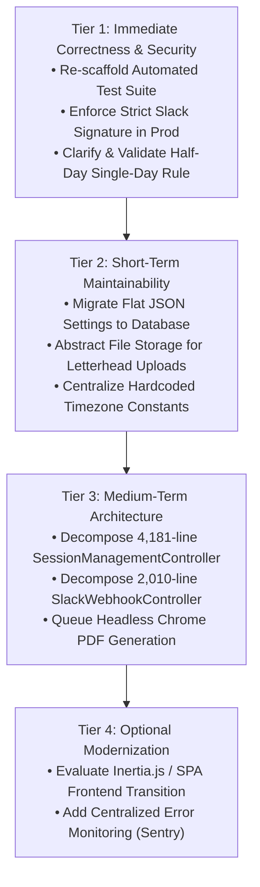

# BeetleOps HRMS — Project Knowledge Pack
## 23-RECOMMENDED-ROADMAP.md: Prioritized Engineering Roadmap

---

### 1. Overview

This roadmap outlines prioritized technical recommendations for the BeetleOps HRMS system. **These items are proposed for future architectural planning and have NOT been implemented during discovery.**

---

### 2. Tiered Improvement Roadmap

---

### Tier 1: Immediate Correctness & Security Concerns

1. **Re-Scaffold Automated Test Suite (Priority: CRITICAL)**
   - **Goal**: Protect core business logic against silent regressions.
   - **Actions**:
     - Create `phpunit.xml` with an in-memory SQLite test configuration.
     - Add Unit tests for `LeaveRequestService::calculateDays()`, `LeaveBalanceService`, and `HierarchyService::wouldCreateCycle()`.
     - Add Feature tests for the multi-tier `LeaveApprovalChainService` escalation and in-flight reset workflow.
     - Add Feature tests for Slack webhook signature verification and keyword parsing.

2. **Enforce Mandatory Slack Signature Verification in Production (Priority: HIGH)**
   - **Goal**: Eliminate potential unauthenticated webhook injection if `SLACK_SIGNING_SECRET` is missing.
   - **Actions**: In `SlackWebhookController::handle()`, throw an explicit configuration error if `app()->isProduction()` is true and the signing secret is not configured.

3. **Validate Single-Day Boundary for Half-Day Leaves (Priority: HIGH)**
   - **Goal**: Prevent multi-day fractional leave applications (e.g., 5 days $\times 0.5 = 2.5$ days).
   - **Actions**: Add an assertion in `LeaveRequestService::submit()` and `requestChange()` ensuring `start_date === end_date` when `is_half_day` is true.

---

### Tier 2: Short-Term Maintainability Improvements

4. **Migrate Flat JSON Files to `system_settings` Database Table (Priority: HIGH)**
   - **Goal**: Ensure ACID transaction safety and cross-node consistency for operational settings.
   - **Actions**:
     - Move `storage/app/salary_deduction_settings.json` and `storage/app/break_settings.json` into the `system_settings` table.
     - Provide automatic database seeding and fallback defaults.

5. **Decouple Asset Uploads from the Public Filesystem (Priority: MEDIUM)**
   - **Goal**: Enable containerized, stateless deployments (Docker, ECS, Kubernetes).
   - **Actions**:
     - Refactor `SalarySlipController::uploadLetterhead()` to store files via `Storage::disk('public')`.
     - Reference the asset via `Storage::url('letterheads/salary_slip_letterhead.png')`.

6. **Centralize Hardcoded Timezone Constants (Priority: MEDIUM)**
   - **Goal**: Eliminate 40+ hardcoded `'Asia/Karachi'` strings scattered across controllers and models.
   - **Actions**: Define `config('hrms.timezone', 'Asia/Karachi')` and update queries to reference the configuration helper.

---

### Tier 3: Medium-Term Architecture Improvements

7. **Decompose `SessionManagementController` (4,181 lines) (Priority: HIGH)**
   - **Goal**: Separate HTTP handling, shift math, and reporting logic.
   - **Actions**:
     - Extract shift reconstruction into `App\Services\AttendanceReconstructionService`.
     - Extract Excel generation into dedicated export classes using Laravel Excel (`Maatwebsite\Excel`).
     - Reduce controller to standard resourceful actions delegating to services.

8. **Decompose `SlackWebhookController` (2,010 lines) (Priority: MEDIUM)**
   - **Goal**: Separate Slack event handling from business presence processing.
   - **Actions**:
     - Extract NLP keyword regex parsing into `App\Services\Slack\SlackMessageParser`.
     - Extract auto-mapping matching logic into `App\Services\Slack\SlackUserMatcher`.

9. **Asynchronous Headless Chrome PDF Generation (Priority: MEDIUM)**
   - **Goal**: Prevent blocking PHP-FPM web worker threads during salary slip generation.
   - **Actions**:
     - Move `Browsershot::html($html)->pdf()` into a background queued job (`GenerateAndSendSalarySlipJob`).
     - Provide asynchronous progress feedback via Pusher, WebSocket, or notification bell.

---

### Tier 4: Optional Modernization

10. **Modernize Frontend with Inertia.js (Priority: LOW)**
    - **Goal**: Provide a seamless, single-page application (SPA) user experience.
    - **Actions**: Gradually transition Blade views and jQuery scripts into Inertia.js with Vue 3 or React, preserving Laravel routing and controller authorizations.

11. **Application Monitoring & Observability (Priority: LOW)**
    - **Goal**: Instant visibility into production exceptions and queue worker failures.
    - **Actions**: Integrate Sentry or Bugsnag for real-time error tracking, and Laravel Horizon for database/Redis queue monitoring.
