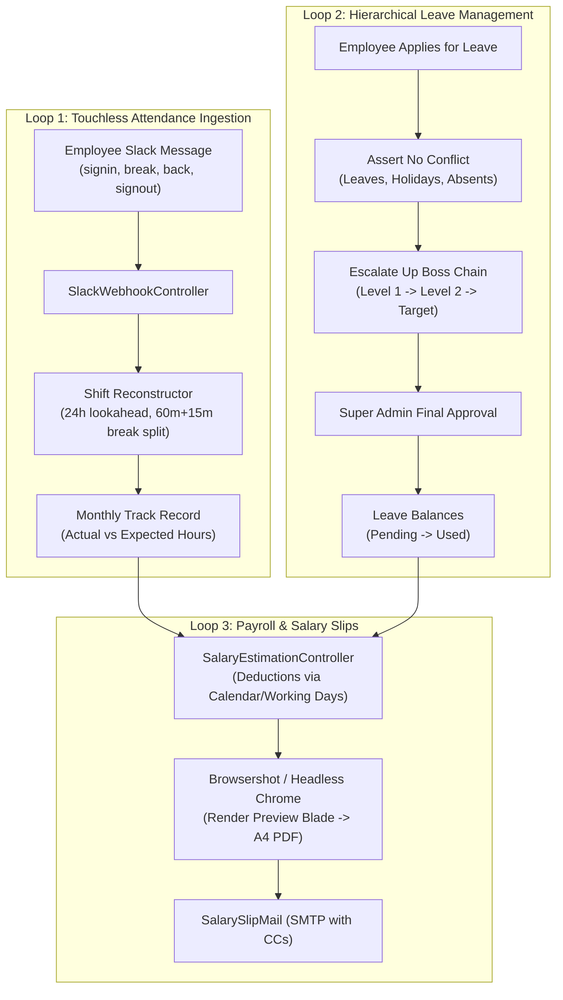

# BeetleOps HRMS — Project Knowledge Pack
## 25-AI-HANDOFF.md: Master Briefing for AI Coding Assistants & Senior Engineers

---

### 1. Welcome & Orientation

Welcome to **BeetleOps HRMS**. You are inheriting an established, production-grade enterprise Human Resource Management System built on Laravel (PHP 8.3+) and MySQL.

Your role when modifying this repository is to act as a careful senior engineer. Because **the automated test suite was deleted in a past commit**, you cannot rely on `php artisan test` to catch regressions. You must understand the invariants, boundaries, and fragile areas documented below before touching code.

---

### 2. High-Level System Mental Model

The system solves workforce management around **three interconnected loops**:

---

### 3. Critical Invariants: What You Must NEVER Assume

1. **DO NOT assume attendance is a simple `timesheets` table**:
   - There is **no timesheet table**.
   - Work hours are dynamically reconstructed on the fly by querying `slack_messages` for a user within a calendar month with a 24-hour forward lookahead to support overnight shifts.
   - Modifying how `SlackMessage` stores or queries timestamps directly impacts attendance logs, track records, salary estimations, and salary slips.

2. **DO NOT assume department managers approve leaves**:
   - Department heads (`departments.head_id`) do **not** approve leaves.
   - Leave routing strictly follows the individual employee's `manager_id` upward via `HierarchyService::getBossChain()`.
   - Always route approvals through `LeaveApprovalChainService`.

3. **DO NOT assume tests exist or pass**:
   - The `tests/` directory was deleted in commit `b41b6fea9f46ce7110f5caaaaa666ab66c11e668`.
   - Never run `php artisan test` expecting coverage. If you make changes, verify manually or write a standalone verification script in `scratch/`.

4. **DO NOT assume the server runs in UTC locally**:
   - Database timestamps are stored in UTC, but all business logic (overnight lookaheads, day boundaries, daily break limits, cron reminders) is explicitly anchored to `'Asia/Karachi'`.
   - Never use `now()` without considering the `Asia/Karachi` timezone when manipulating attendance dates.

5. **DO NOT assume break time is a single continuous period**:
   - An employee can take multiple short breaks throughout the day.
   - If accumulated break time exceeds 60 minutes + 15 minutes grace period (75 minutes total), any further break duration is automatically converted into an unpaid session-out (`break_exceeded = true`).

6. **DO NOT assume all registered users can access the portal**:
   - New registrations are created with `approval_status = 'pending'`.
   - The `EnsureAccountApproved` middleware strictly blocks them from `/admin/*` routes until activated by a Super Admin via `AccountApprovalController`.

---

### 4. What Files to Inspect Before Modifying Subsystems

| Subsystem to Modify | Files to Inspect First | Key Symbols to Read |
|---|---|---|
| **Slack Ingestion & Keywords** | `app/Http/Controllers/SlackWebhookController.php` `app/Models/SlackMessage.php` | `getNormalizedMessageText()` `processOverrideApproval()` `computeDayBreakBalance()` |
| **Attendance & Shift Reconstruction** | `app/Http/Controllers/SuperAdmin/SessionManagementController.php` | `reconstructSessions()` `calculateMonthlyTrackRecordData()` |
| **Leave Application & Quotas** | `app/Services/LeaveRequestService.php` `app/Services/LeaveBalanceService.php` | `submit()` `assertNoOverlap()` `availableDays()` |
| **Leave Approval Escalation** | `app/Services/LeaveApprovalChainService.php` `app/Models/LeaveApprovalChain.php` | `recordApproval()` `getNextApprover()` `resetChain()` |
| **Org Chart & Management Tree** | `app/Services/HierarchyService.php` `app/Models/User.php` | `computeOrganizationTree()` `getBossChain()` `getSubordinateIdsAttribute()` |
| **Payroll Deductions & Estimations** | `app/Http/Controllers/SuperAdmin/SalaryEstimationController.php` | `computeCompanyPayroll()` `storage/app/salary_deduction_settings.json` |
| **Salary Slip PDF & Email** | `app/Http/Controllers/SuperAdmin/SalarySlipController.php` `resources/views/super-admin/salary-slips/preview-page.blade.php` | `calculateSalarySlipData()` `sendEmail()` |
| **In-App Notifications** | `app/Http/Controllers/NotificationController.php` `public/js/notifications.js` | `mapNotificationUrl()` `unreadCount()` |

---

### 5. Known Fragile Areas & Bug Suspects

1. **Multi-Day Half-Day Leaves**:
   - `LeaveRequestService::submit()` applies `$days = $days * 0.5` without asserting that `start_date === end_date`. If a user applies for a 5-day range, it records 2.5 days. Confirm with product specifications whether half-day leaves must be single-day only.
2. **Auto-Appended Virtual Sign-Outs**:
   - When an unclosed shift is healed, `SlackMessage` sets the virtual sign-out to check-in + 1 minute. The employee only receives credit for 1 minute of work on that day. Look for `virtual_out_reason === 'Auto-Appended Sign Out'`.
3. **Flat JSON Settings in `storage/app/`**:
   - `salary_deduction_settings.json` and `break_settings.json` are unversioned and unmigrated. Ensure any modifications do not write invalid JSON or overwrite concurrent changes.

---

### 6. Step-by-Step Safe Workflow for AI Assistants

When asked to implement a bugfix or feature:
1. **Locate & Read**: Read the target controller, model, and corresponding service from the table above.
2. **Check Invariants**: Ensure your proposed changes do not violate the 6 critical invariants listed in Section 3.
3. **Trace Impact**: Refer to [`19-CHANGE-IMPACT-GUIDE.md`](file:///Users/adeelbukhari/Documents/Projects/hrms/.ai-project-context/19-CHANGE-IMPACT-GUIDE.md) to check all related migrations, models, services, and views.
4. **Preserve Comments & Conventions**: Follow the conventions documented in [`20-ENGINEERING-CONVENTIONS.md`](file:///Users/adeelbukhari/Documents/Projects/hrms/.ai-project-context/20-ENGINEERING-CONVENTIONS.md).
5. **Verify Without Test Suite**:
   - Run syntax checks: `php -l path/to/file.php`.
   - If testing business logic, write an ad-hoc verification script in `scratch/` (similar to `scratch/verify_account_approval_flow.php`) to test your logic using the booted Laravel kernel.
